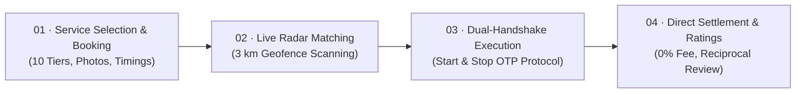
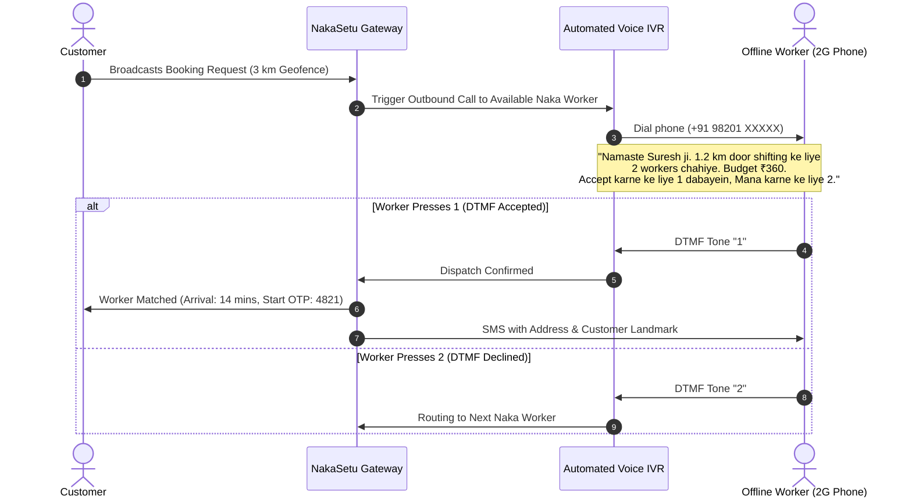

<div align="center">

# 🌉 NakaSetu (नाका सेतु)
### *Hyperlocal 30-Minute Labor & Skilled Service Gateway*

**Bridging the Digital Divide Between Modern Urban Households and India's 450M+ Offline Blue-Collar Workforce.**

<br />

[](https://code-vibers-dhruv-surti-naka-setu-ten.vercel.app/)
[](https://youtu.be/eFp7sUV7hm0)
[](https://react.dev/)
[](https://www.typescriptlang.org/)
[](https://tailwindcss.com/)
[](LICENSE)

<br />

[Explore Live Demo](https://code-vibers-dhruv-surti-naka-setu-ten.vercel.app/) • [Watch Demo Video (YouTube)](https://youtu.be/eFp7sUV7hm0) • [Problem Statement](#-the-problem--real-world-context) • [System Architecture](#-system-architecture--technical-deep-dive) • [Dual Workspaces](#-dual-workspace-experience) • [Inclusion Protocol](#-voice-over-2g-inclusion-protocol) • [Quickstart](#-developer-quickstart)

<br />

---

</div>

## 📌 Executive Summary

Every morning at 6:30 AM across cities in India, millions of skilled tradespeople (electricians, plumbers, carpenters) and daily-wage laborers gather physically at **Labor Nakas** (street corners and chowks). They wait hours on curbsides in hopes of informal work, vulnerable to exploitative contractor margins (*mukadams* taking up to 35%), payment defaults, and volatile demand.

Simultaneously, urban households face acute friction when seeking timely, reliable domestic or trade help: lengthy booking windows on legacy apps, inflated convenience fees, and total absence of safety/credential verification.

**NakaSetu (नाका सेतु)** provides an **inclusive, hyperlocal on-demand dispatch infrastructure** delivering **<30-minute verified labor** while solving the critical smartphone access barrier through **automated 2G Voice IVR & DTMF loopback**.

<br />

---

## 💡 The Core Innovation: Solving The 2G Accessibility Paradox

```
                  ┌─────────────────────────────────────────────────┐
                  │          Smartphone Urban Customer             │
                  │   (On-Demand Glassmorphic Progressive Web App)   │
                  └───────────────────────┬─────────────────────────┘
                                          │ 3 km Geofence Request
                                          ▼
                  ┌─────────────────────────────────────────────────┐
                  │            NakaSetu Core Dispatch Engine        │
                  │  (Dual-Handshake OTP + GeoRadar Routing Engine) │
                  └───────────┬─────────────────────────┬───────────┘
                              │                         │
         Smartphone Partners  │                         │ Offline / Feature Phone
         (FCM Push & PWA)     ▼                         ▼ (2G Voice Telephony)
            ┌───────────────────┐             ┌──────────────────────────────┐
            │ Digital App Roster│             │  Automated Bilingual IVR     │
            │ • Digital KYC     │             │  • Dial-out via PSTN gateway │
            │ • Live In-App Job │             │  • [1] Accept | [2] Decline  │
            │ • Instant UPI QR  │             │  • SMS Work Order Ticket     │
            └───────────────────┘             └──────────────────────────────┘
```

> **The Insight**: Blue-collar gig platforms routinely fail because they demand 4G smartphones, high data literacy, and heavy apps. Over **70% of Naka workers use ₹1,200 basic feature phones**. NakaSetu enables any worker with a dialable 2G number to receive, evaluate, and accept jobs without ever touching a smartphone.

<br />

---

## 🎯 Key Differentiators & Impact Metrics

| Metric / Dimension | Traditional Labor Nakas | Legacy Gig Apps (UC, TaskRabbit) | **NakaSetu Gateway** |
|:---|:---|:---|:---|
| **Dispatch Latency** | 2–4 hours (physical commute) | 3–6 hours / Next-day slots | **⚡ Under 30 minutes guaranteed** |
| **Worker Inclusivity** | 100% Offline (Cash only) | Smartphone + 4G App Mandatory | **Universal (Smartphone + 2G Voice IVR)** |
| **Platform Take-Rate** | 20–35% Contractor cut | 20–30% Platform commission | **0% Commission (100% Direct to Worker)** |
| **Safety & Credentialing** | Zero vetting / Street-level | Basic background checks | **Dual OTP + Geo-Fence + Police SOS** |
| **Payment Settlement** | Disputed cash settlements | Delayed bank payouts (T+3) | **Instant Direct UPI QR or Cash-in-Hand** |
| **Feedback Loop** | One-sided or non-existent | Customer-only rating | **Two-Way Reciprocal Rating System** |

<br />

---

## 📱 Dual-Workspace Experience

### Workspace 1: Customer App View & Verified Trust Lifecycle

A structured 4-step progressive workflow engineered for zero cognitive friction:



#### 1. Comprehensive 10-Service Catalog
Fixed base tariffs prevent street haggling while guaranteeing fair living wages:
- **🛠️ Skilled Trades**:
  - **Electrician** (`₹199 / visit` · 14m ETA) — MCB fault diagnosis, ceiling fan & switchboard installation.
  - **Plumber** (`₹199 / visit` · 14m ETA) — Pipe leakages, tap replacements, drain unclogging, overhead tank fittings.
  - **Carpenter** (`₹249 / visit` · 22m ETA) — Lock repairs, hinge realignments, modular bed/cabinet assemblies.
  - **Painter** (`₹299 / visit` · 25m ETA) — Wall dampness waterproofing, surface putty coats, room touch-ups.
  - **Appliance Repair** (`₹249 / visit` · 20m ETA) — AC maintenance, washing machines, refrigerators, geysers.
- **🧹 Domestic & Naka Labor**:
  - **House Maid** (`₹150 / hr` · 15m ETA) — On-demand sweeping, mopping, utensil cleaning, kitchen tidy-up.
  - **Cook** (`₹200 / meal` · 18m ETA) — Fresh home-style meals (roti, sabzi, dal, rice) for up to 4 persons.
  - **Luggage / Furniture Shifting** (`₹180 / hr` · 19m ETA) — Appliance handling, tempo loading, multi-floor toli moving.
  - **Compound / Terrace Cleaning** (`₹250 flat` · 21m ETA) — Heavy debris clearance, pressure washing, drain desilting.
  - **General Loader / Helper** (`₹150 / hr` · 12m ETA) — Daily-wage Naka helper for construction supplies & shop stock.

#### 2. Advanced Dispatch Configuration
- **Urgency Selector**: Toggle between **Immediate 30-Min Dispatch** or **Scheduled Time Slots**.
- **Media Diagnostic Attachments**: Customers can upload images (e.g., pipe crack, broken MCB) directly to the dispatch ticket.
- **Interactive Radar Scan**: Real-time 3 km animated geofence visualizer broadcasting calls across nearby Naka clusters.

#### 3. Dual-Handshake OTP Protocol (Safety First)
- **Start OTP (`4821`)**: Verified on worker arrival to initiate session timer and unlock insurance protection.
- **Stop OTP (`9306`)**: Given by customer only upon successful completion and inspection of work.
- **Proxy Masked Calling**: Embedded private proxy bridge (`+91 22-4890-7712`) keeps mobile numbers anonymous.
- **Police Desk SOS Broadcast**: Instant emergency button streaming live GPS coordinates (`19.1136° N, 72.8697° E`) and verified worker KYC to local municipal emergency services.

#### 4. Zero-Fee Settlement & Two-Way Reciprocity
- **100% Worker Retainment**: Itemized digital invoice with strictly ₹0 platform deductions.
- **Payment Flexibility**: Instant direct UPI QR code generation (`rameshpawar.naka@upi`) or cash with instant SMS receipt.
- **Reciprocal Feedback**: Customers rate technical performance; workers simultaneously rate customer conduct (politeness, clear task scope, prompt payment) via IVR or App.

---

### Workspace 2: Field Operations & Call Desk

Designed for field agents, municipal labor officers, and community helpline managers:

- **Offline Naka Enrollment Desk**:
  - Rapid onboarding of walk-in laborers across major hubs: *Station Road Chowk, Bharti Park Naka, Andheri East Naka, Kurla Station Naka, Dadar West Kabutarkhana*.
  - **Toli (Labor Crew) Capacity Selector**: Register individuals as **Solo**, **Group of 2**, or **Group of 3-4 Helpers** (enabling group jobs like concrete lifting or household shifting).
  - Physical inspection badges and trade certification flags.
- **Live Unified Worker Directory**:
  - Real-time roster tracking device types (Smartphone vs. 2G Feature Phone), group size, verification state, ratings, and live availability (`Available`, `Dispatched`, `On Job`).
  - Instant search and device-type filtering.
- **Simulated 2G Outbound Voice Call (IVR Engine)**:
  - Realistic audio dispatch modal delivering bilingual Hindi/English synthesized prompts.
  - **Interactive DTMF Keypad Response**:
    - **Press 1**: Worker accepts job $\rightarrow$ Updates roster status to `"Dispatched (SMS Sent)"`.
    - **Press 2**: Worker declines job $\rightarrow$ Instantly re-routes the radar dispatch to the next available worker.

---

### Partner Self-Registration Modal (Smartphone Pros)
- Digital self-onboarding flow for independent technicians and Toli leads.
- Upload Aadhaar and ITI Trade Certificates (`aadhaar_trade_cert_verified.pdf`) with automated digital KYC verification tagging.

<br />

---

## 🔊 Voice-over-2G Inclusion Protocol

The standout technical solution in NakaSetu is eliminating the smartphone requirement for service providers:



<br />

---

## 🎨 UI/UX & Design Architecture

NakaSetu is styled with an **Ocean Blue Glassmorphic Palette** optimized for clarity, legibility, and modern aesthetics:

- **Color Tokens**:
  - `Surface Canvas`: `#F0F9FF` (Light Sky Mist)
  - `Primary Brand Accent`: `#0284C7` (Sky 600)
  - `Typography`: `#0F172A` (Deep Slate / Navy)
  - `Card Borders`: `#E0F2FE` (Subtle Sky Glass)
  - `Verification Badges`: `#065F46` on `#D1FAE5` (Emerald Semantic Green)
  - `Emergency / SOS`: `#DC2626` on `#FEE2E2` (Semantic Alert Red)
- **Glassmorphism**: Soft frosted acrylic overlays (`backdrop-blur-lg`) with ambient radial gradient mists.
- **Design System**: Fully responsive mobile-first architecture utilizing native [Tailwind CSS v4](https://tailwindcss.com/) variables.

<br />

---

## 💻 Tech Stack & Engineering Standards

```
├── Framework:        React 19 (Hooks, Concurrent Mode, useMemo)
├── Language:         TypeScript 5 (Strict Mode, Zero Any)
├── Styling:          Tailwind CSS v4 (Modern CSS Engine)
├── Icons:            Lucide React (Optimized Tree-shakeable SVG Icons)
├── Build Engine:     Vite 8 (Lightning-fast ESM HMR)
├── Cloud Platform:   Vercel Edge Network (Global CDN)
└── Architecture:     Pure Client-Side SPA with 100% Zero-Cost Operating Model
```

- **Zero-Cost Deployment**: Built deliberately to operate permanently without billing constraints—no mandatory paid APIs, no credit card requirements, no compute lock-in.
- **Enterprise SPA Routing**: Bundled with custom [`vercel.json`](vercel.json) rewrites preventing 404s on browser reloads.

<br />

---

## 🚀 Developer Quickstart

Follow these steps to run the complete environment locally in under 2 minutes:

### 1. Prerequisites
- **Node.js**: v18.x, v20.x, or v22.x
- **Package Manager**: `npm` or `pnpm`

### 2. Clone & Install
```bash
# Clone the repository
git clone https://github.com/Ditrus24/CodeVibers_Dhruv-Surti_NakaSetu.git
cd CodeVibers_Dhruv-Surti_NakaSetu

# Install dependencies
npm install --legacy-peer-deps
```

### 3. Environment Configuration
The project is architected to run immediately without requiring third-party API keys:
```bash
cp .env.example .env
```

### 4. Run Development Server
```bash
npm run dev
```
Visit `http://localhost:3000` in your browser.

### 5. Production Build & Inspection
```bash
npm run build
npm run preview
```

<br />

---

## 📁 Repository Directory Structure

```text
CodeVibers_Dhruv-Surti_NakaSetu/
├── .env.example             # Clean environment template with live production URL
├── .env                     # Local environment file (git-ignored for secrets)
├── vercel.json              # Vercel Single-Page-App routing rewrite configuration
├── index.html               # Semantic HTML5 entry document
├── package.json             # Manifest with scripts, React 19, and Tailwind v4
├── tsconfig.json            # Strict TypeScript configuration
├── vite.config.ts           # Bundler setup with path aliases
└── src/
    ├── main.tsx             # React 19 DOM bootstrap
    ├── App.tsx              # Top-level shell component
    ├── index.css            # Tailwind CSS v4 directives & theme variables
    └── NakaSetuApp.tsx      # Core platform containing:
                             #  • 10-Service Catalog Data & Rate Engine
                             #  • 4-Step Customer Trust Lifecycle & Modals
                             #  • Field Operations & Roster Table
                             #  • 2G Bilingual Voice IVR & DTMF Simulation
                             #  • Dual OTP Verification & Settlement Handlers
```

<br />

---

## 🗺️ Roadmap & Future Enhancements

- [x] Hyperlocal 30-min booking flow with 10 fixed-rate service categories.
- [x] Dual-Handshake Start (`4821`) and Stop (`9306`) OTP validation.
- [x] Interactive 2G Voice IVR & DTMF dispatch simulation.
- [x] Emergency Police Ward SOS with GPS coordinate telemetry.
- [x] Zero-commission direct UPI QR settlement model.
- [ ] Integration with Twilio / Exotel Voice API for real outbound PSTN phone calls.
- [ ] Multi-lingual speech recognition using Google Gemini 2.5 Flash for audio task notes.
- [ ] On-chain worker credential anchoring for portable Aadhaar-backed trade reputations.

<br />

---

## 📄 License

This project is licensed under the **Apache-2.0 License** — see the [LICENSE](LICENSE) file for full details.

<br />

<div align="center">

**Built with pride for inclusive digital infrastructure.**<br />
*Bridging the street-corner labor chowk with the digital economy.*

</div>
